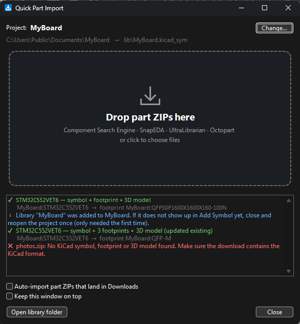

# Quick Part Import for KiCad

Drop the ZIP you downloaded from **Component Search Engine (SamacSys)**, **SnapEDA**,
**UltraLibrarian** or **Octopart** onto a window – the part is in your project, with
symbol, footprint and 3D model linked and ready to place.



- **One library per project, inside the project folder** – nothing scattered across global
  libraries, and the project stays portable (zip it, commit it, open it on another PC).
- **Zero setup** – the library is registered in the project's `sym-lib-table` /
  `fp-lib-table` automatically, with `${KIPRJMOD}` paths.
- **Everything linked** – the symbol's Footprint field points at the imported footprint,
  the footprint points at its 3D model.
- **Safe** – importing a part again updates it (no duplicates); a failed or broken
  download never changes anything; existing table entries are left untouched.
- **Auto-import (optional)** – tick a box and every part ZIP that lands in your Downloads
  folder is imported a second later. Click "Download" on the website, done.
- Handles all KiCad formats in the downloads: `.kicad_sym`, old `.lib`/`.dcm`,
  `.kicad_mod`, old `.mod`, STEP/WRL models, footprint density variants, nested ZIPs,
  and ZIPs that contain every CAD format under the sun (only the KiCad files are used).

## Install

Requires KiCad 9 or 10 with the API enabled: **Preferences → Plugins → Enable KiCad API**.

**Option A – with automatic updates (recommended)**

1. KiCad → **Plugin and Content Manager** → **Manage…** (repositories) → **Add**, and paste
   ```
   https://raw.githubusercontent.com/Jiggolino/kicad-quick-part-import/main/pcm/repository.json
   ```
2. Pick "Quick Part Import by Jiggolino" in the repository list, install **Quick Part
   Import**, then **Apply Pending Changes**.

**Option B – from file**

1. Download `kicad-quick-part-import-<version>.zip` from the
   [latest release](https://github.com/Jiggolino/kicad-quick-part-import/releases/latest).
2. KiCad → **Plugin and Content Manager** → **Install from File…** → pick the zip.

Restart KiCad afterwards. The first start of the plugin takes a few seconds while KiCad
sets up its Python environment.

## Use

1. Open your project, click the **Quick Part Import** button (blue download arrow) in the
   schematic or PCB editor toolbar.
2. Drag part ZIPs onto the window, or click the drop area to pick files.
3. Place the part: **Add Symbol** → library named like your project.

The window stays open next to KiCad. Clicking the toolbar button again brings it to the
front and switches to the project of the editor you clicked in. With several KiCad
windows open it figures out which project is meant; **Change…** lets you pick one.

> The very first import into a project adds the library to the project. If KiCad does
> not list it yet, close and reopen the project once.

## Where the files go

```
MyBoard/
├── MyBoard.kicad_pro
├── sym-lib-table              ← library "MyBoard" added here
├── fp-lib-table               ← and here
└── lib/
    ├── MyBoard.kicad_sym      all imported symbols
    ├── MyBoard.pretty/        all footprints
    └── MyBoard.3dshapes/      all 3D models
```

## Troubleshooting

Errors are shown in the window. The full log of the last session is
`quick_part_import.log` in KiCad's plugin settings folder, e.g.
`%APPDATA%\kicad\10.0\plugins\com.github.Jiggolino.kicad-quick-part-import\`
(next to `settings.json`, where `"downloads_folder"` can point the auto-import at
another folder).

## Development

```
plugins/            the plugin (what KiCad installs)
  quick_import.py     window, drag & drop, download watcher
  part_importer.py    import logic, no GUI – usable on its own
  project_detect.py   finds the project open in KiCad
metadata.json       package info – bump the version here
tools/build.py      builds the package and the PCM repository files in pcm/
tests/              tests with small hand-made KiCad files
```

Run the tests with KiCad's Python (they use `kicad-cli`):

```
"C:\Program Files\KiCad\10.0\bin\python.exe" tests/test_importer.py
```

Release: bump the version in `metadata.json`, run `python tools/build.py`, commit, then
push a tag `v<version>` – the workflow attaches the package to a GitHub release.

Tested on Windows with KiCad 10.0. Linux/macOS should work but are untested.

## License

MIT
